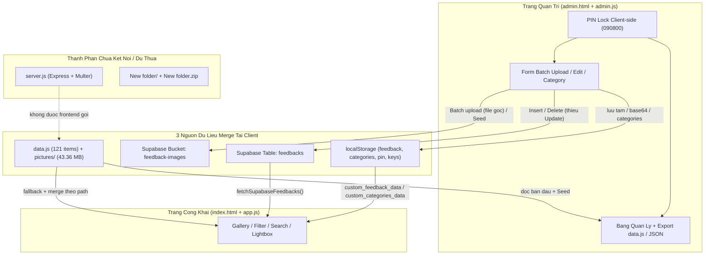

# Bảng Phân Tích Hiện Trạng & Phương Án Hoàn Thiện Website Kho Feedback

> **Tài liệu đề xuất trước khi triển khai code**
> - **Workspace:** `d:\Documents\feedback - Copy`
> - **Ngày lập:** 21/11/2026
> - **Phạm vi:** Đọc toàn bộ cấu trúc thư mục và mã nguồn hiện tại; tổng hợp kiến trúc, chỉ ra lỗi/thiếu sót/điểm chưa tối ưu và đề xuất lộ trình hoàn thiện theo từng giai đoạn để rà soát & chốt đầu việc.

---

## 1. Tổng Quan Kiến Trúc Dự Án Hiện Tại

Dự án **Kho Feedback — Minh Chứng Giao Dịch** được xây dựng theo mô hình **Static Web Frontend (Vanilla HTML/CSS/JS)** không qua bundler/framework, kết hợp **Supabase** làm backend đám mây (Database + Object Storage), **`localStorage`** làm bộ nhớ đệm trình duyệt và **`data.js`** làm dữ liệu tĩnh fallback kèm thư mục ảnh **`pictures/`**. Ngoài ra trong repo có một server Node.js/Express (`server.js`) phục vụ upload local nhưng hiện frontend không kết nối tới.

### 1.1. Danh sách tệp tin, thư mục và vai trò

| Thành phần | Dung lượng / Quy mô | Vai trò & Trạng thái hiện tại |
| --- | --- | --- |
| [`index.html`](../../index.html) | 476 dòng | Trang chủ công khai: Header, Hero (3D phone mockup, stats counter, badges), Marquee ticker, lưới Danh mục, Kho Feedback (tìm kiếm, lọc, phân trang 15 ảnh/trang), Hướng dẫn 3 bước, Trust banner, Footer, Lightbox modal, nút Back-to-Top. |
| [`app.js`](../../app.js) | 653 dòng | Logic giao diện công khai: merge dữ liệu 3 nguồn (`Supabase` + `localStorage` + `data.js`), khử trùng theo `path`, đếm danh mục, render gallery phân trang, lọc/tìm kiếm, Lightbox (zoom, phím tắt, vuốt chạm mobile, tải ảnh), counter animation. |
| [`style.css`](../../style.css) | 1.764 dòng | Stylesheet giao diện chính (Dark Glassmorphism + Neon Lime/Cyan), dùng chung cho cả `index.html` và `admin.html`. Chứa một số rule CSS chưa dùng (`.filter-tabs*`) và rule ẩn nav mobile ảnh hưởng cả trang Admin. |
| [`admin.html`](../../admin.html) | 1.193 dòng | Trang quản trị: màn hình khóa mã PIN, bảng thống kê, form thêm/sửa feedback (hỗ trợ chọn/kéo-thả nhiều ảnh), bảng danh sách phân trang, panel cấu hình Supabase + nút Seed + SQL mẫu, đổi PIN, JSON Backup, quản lý danh mục. Đang chứa ~400 dòng CSS inline và ~300 dòng JS inline, kèm lỗi đóng thiếu thẻ `<div>`. |
| [`admin.js`](../../admin.js) | 916 dòng | Logic quản trị: xác thực PIN phía client, nạp & merge dữ liệu 3 nguồn, tính thống kê, render bảng phân trang 10 dòng/trang, sửa/xóa item, quản lý danh mục động (`localStorage`), xuất `data.js` & JSON Backup, Seed từ `data.js` lên Supabase. |
| [`supabase-config.js`](../../supabase-config.js) | 199 dòng | Khởi tạo `@supabase/supabase-js@2` (CDN), cung cấp hàm CRUD bảng `feedbacks` (`fetch`, `add`, `addMultiple`, `delete`, `update`) và upload Storage bucket `feedback-images`. Chưa có CRUD cho danh mục và chưa xử lý xóa file trên Storage. |
| [`data.js`](../../data.js) | 49 dòng | Chứa `feedbackData` (**121** item khớp 100% file trong `pictures/`, 0 file thiếu, 0 đường dẫn trùng) và `CATEGORY_DATA` (**5** danh mục vũ khí). |
| [`pictures/`](../../pictures) | 126 file / **43.36 MB** | Gồm 5 thư mục feedback (`ak riu thiêng`: 30, `dao bướm`: 24, `dù saitama`: 12, `m4a1 Battle of Faith`: 28, `M700 ELIZABETH`: 27) và thư mục `thẻ` (5 ảnh đại diện danh mục). Ảnh gốc chưa nén WebP. |
| [`assets/demo/`](../../assets/demo) | 3 file PNG | `feedback-01.png`, `feedback-02.png`, `feedback-03.png` dùng cho mockup 2 điện thoại ở Hero và ảnh fallback khi gallery rỗng. |
| [`server.js`](../../server.js) & [`package.json`](../../package.json) | 104 dòng / Express + Multer | Server local cung cấp `GET /api/feedbacks` và `POST /api/feedbacks/upload` ghi trực tiếp vào `pictures/` và `data.js`. **Hiện tại frontend (`index.html`, `admin.html`) không gọi bất kỳ API nào của server này.** |
| [`seed-supabase.js`](../../seed-supabase.js) & [`test.js`](../../test.js) | 61 dòng / 21 dòng | Script CLI Node.js đẩy `data.js` lên Supabase REST API và script test nhanh đọc `data.js` bằng `eval`. |
| [`netlify.toml`](../../netlify.toml), [`_redirects`](../../_redirects), [`vercel.json`](../../vercel.json) | Config deploy | Đang tồn tại song song cấu hình rewrite `/admin` -> `/admin.html` cho Netlify và `cleanUrls` cho Vercel. |
| [`.github/workflows/keep-alive.yml`](../../.github/workflows/keep-alive.yml) | 19 dòng | GitHub Actions cron chạy mỗi 3 ngày ping Supabase REST API để tránh project bị auto-pause trên gói miễn phí. |
| `New folder/` & `New folder.zip` | Untracked | Bản sao cũ các file mã nguồn (khớp hash với bản gốc ở root tại thời điểm kiểm tra) kèm file Photoshop ExtendScript `Kho_Feedback_Website_UI.jsx` (593 dòng) và file nén backup. |

### 1.2. Sơ đồ luồng dữ liệu & kiến trúc hiện tại



---

## 2. Phân Tích Chi Tiết Lỗi, Thiếu Sót & Điểm Chưa Tối Ưu

### Nhóm A — Bảo mật & Phân quyền (Ưu tiên: Rất cao)

| Mã | Hạng mục & Vị trí | Hiện trạng & Tác động | Phương án khắc phục đề xuất |
| --- | --- | --- | --- |
| **A1** | **Khóa PIN Admin client-side & backdoor cứng**<br>[`admin.html` (L539–L541)](../../admin.html#L539-L541), [`admin.js` (L86–L116)](../../admin.js#L86-L116) | Mã PIN mặc định `"090800"` nằm lộ thiên trong JS/HTML. Kể cả khi người dùng đổi PIN mới lưu vào `localStorage`, điều kiện `val === "090800" || val === savedPin` vẫn luôn cho phép đăng nhập bằng `"090800"`. Ngoài ra chỉ kiểm tra `sessionStorage.getItem("admin_auth_session") === "true"` nên bất kỳ ai mở DevTools đều vượt qua ngay. | Thay cơ chế khóa PIN giả lập bằng **Supabase Auth** (đăng nhập bằng email/mật khẩu Admin thật, quản lý session qua `supabaseClient.auth`). Nếu vẫn muốn giữ PIN làm lớp khóa nhanh màn hình tại chỗ, cần bỏ ngay backdoor `"090800"` và tuyệt đối không dùng nó làm ranh giới bảo mật cho thao tác ghi/xóa DB. |
| **A2** | **Supabase RLS mở toàn quyền ghi/xóa cho public**<br>[`admin.html` (L1061–L1069)](../../admin.html#L1061-L1069), [`supabase-config.js` (L8–L9)](../../supabase-config.js#L8-L9), [`keep-alive.yml` (L15–L17)](../../.github/workflows/keep-alive.yml#L15-L17) | Do `SUPABASE_URL` và `SUPABASE_ANON_KEY` (`sb_publishable_...`) công khai trong frontend và workflow GitHub, trong khi SQL policy đang mở `INSERT`/`DELETE` bảng `feedbacks` và `INSERT` bucket `feedback-images` với `USING (true)` / `WITH CHECK (true)`, bất kỳ ai bên ngoài đều có thể gọi REST API để xóa toàn bộ feedback hoặc spam dung lượng Storage. | Cập nhật chính sách RLS trên Supabase: `SELECT` công khai cho khách xem trang chủ; `INSERT`, `UPDATE`, `DELETE` trên bảng `feedbacks`, bảng `categories` và `storage.objects` chỉ cho phép `authenticated` (hoặc kiểm tra đúng `auth.uid()` / email Admin). |
| **A3** | **Nguy cơ XSS & vỡ sự kiện `onclick` do `innerHTML` không escape**<br>[`app.js` (L220–L353)](../../app.js#L220-L353), [`admin.js` (L285–L540)](../../admin.js#L285-L540), [`admin.html` (L665–L671)](../../admin.html#L665-L671) | Tiêu đề, tên danh mục, tên file, đường dẫn được nội suy trực tiếp vào HTML và inline `onclick="previewImageModal('${imgSrc}')"` / `onclick="editFeedbackItem('${item.id}')"`. Nếu dữ liệu có dấu nháy đơn `'`, ngoặc kép `"` hoặc thẻ `<script>`/`` sẽ làm hỏng nút bấm hoặc gây XSS. | Viết hàm `escapeHtml()` dùng chung để bọc toàn bộ text trước khi đưa vào DOM, và chuyển các nút trong bảng/thẻ sang dùng `data-id` + event delegation (`addEventListener`) thay cho inline `onclick="..."`. |
| **A4** | **Lỗ hổng ở `server.js` nếu giữ chạy local**<br>[`server.js` (L17–L18, L90–L91)](../../server.js#L17-L91) | `req.body.category` truyền thẳng vào `path.join(__dirname, "pictures", category)` có nguy cơ Path Traversal (`../`); đồng thời khi lưu lại `data.js` ở dòng 90 chỉ ghi `const feedbackData = ...` làm **xóa mất mảng `CATEGORY_DATA`** cuối file `data.js`. | Nếu quyết định giữ `server.js`, cần sanitize tên thư mục (`path.basename` / whitelist danh mục), bảo toàn `CATEGORY_DATA` khi ghi file `data.js`, và bổ sung endpoint sửa/xóa đồng bộ. Nếu chuyển hẳn sang Supabase làm backend chính thì có thể loại bỏ `server.js` để tránh phân mảnh. |

---

### Nhóm B — Lỗi Logic & Đồng Bộ Dữ Liệu (Ưu tiên: Cao)

| Mã | Hạng mục & Vị trí | Hiện trạng & Tác động | Phương án khắc phục đề xuất |
| --- | --- | --- | --- |
| **B1** | **Chỉnh sửa (Edit) feedback không lưu lên Supabase & mất sau F5**<br>[`admin.html` (L705–L721)](../../admin.html#L705-L721), [`admin.js` (L236, L764)](../../admin.js#L236), [`supabase-config.js` (L183–L199)](../../supabase-config.js#L183-L199) | Nhánh Edit trong `handleAdminFormSubmit()` chỉ sửa mảng `adminItems` trong RAM và gọi `saveCustomItems()`, hoàn toàn **không gọi** `updateSupabaseFeedback()` (dù hàm đã viết sẵn) và SQL RLS ở `admin.html` cũng thiếu policy `UPDATE`. Ngoài ra không gán `isEdited = true`, nên `saveCustomItems()` lọc bỏ các item `isBase`/`isSupabase` -> tải lại trang là mất sạch thay đổi. Đồng thời `editFeedbackItem()` gán `$("#categorySelect").value = item.category` trong khi `data.js` viết `"ak riu thiêng"` còn `<option>` là `"Ak Riu Thiêng"`, làm dropdown nhảy sai về mục đầu tiên. | Gọi `updateSupabaseFeedback()` (upload ảnh mới lên Storage nếu có thay đổi file) + bổ sung policy `UPDATE` trên Supabase; dùng `matchCategory()` để chọn đúng `<option>` khi mở form Sửa; đánh dấu `isEdited = true` hoặc đồng bộ lại từ Supabase sau khi cập nhật. |
| **B2** | **Thêm feedback bằng đường dẫn thủ công bỏ qua Supabase**<br>[`admin.html` (L782–L808)](../../admin.html#L782-L808) | Nhánh 3 (nhập URL/đường dẫn vào `#imagePathInput`) chỉ lưu vào `adminItems` và `localStorage`, không gọi `addSupabaseFeedback()`, nên ảnh thêm bằng URL chỉ hiện trên trình duyệt của người đăng. | Tích hợp `addSupabaseFeedback()` vào nhánh thêm bằng URL thủ công khi Supabase đang kết nối. |
| **B3** | **Xóa item gốc bị "hồi sinh" & để lại rác trên Supabase Storage**<br>[`app.js` (L100–L102)](../../app.js#L100-L102), [`admin.js` (L218, L783–L813)](../../admin.js#L218), [`supabase-config.js` (L165–L180)](../../supabase-config.js#L165-L180) | Khi dữ liệu đã chuyển sang Supabase, frontend vẫn luôn merge `[...supaData, ...customData, ...baseData]` theo `path`. Do đó hễ xóa một item có mặt trong `data.js`, lần F5 sau `data.js` lại đẩy item đó hiện trở lại. Ngoài ra `deleteSupabaseFeedback()` chỉ xóa row DB, không xóa file ảnh tương ứng trong bucket `feedback-images`. | Khi Supabase hoạt động và đã có dữ liệu (hoặc sau khi seed), ưu tiên dùng Supabase làm **nguồn dữ liệu chính (Single Source of Truth)** thay vì trộn ngược `data.js` vào gây hồi sinh item đã xóa; đồng thời tách path file Storage từ public URL để gọi `storage.from('feedback-images').remove([...])` khi xóa item. |
| **B4** | **Danh mục động không đồng bộ lên Supabase**<br>[`admin.js` (L41–L43)](../../admin.js#L41-L43), [`app.js` (L10–L31)](../../app.js#L10-L31) | Thêm, sửa màu/ảnh, xóa danh mục ở trang Admin chỉ ghi vào `localStorage` (`custom_categories_data`). Khách hàng truy cập từ máy/trình duyệt khác sẽ không thấy danh mục mới hoặc chỉnh sửa mới. | Tạo thêm bảng `categories` trên Supabase (gồm `id`, `name`, `accent`, `image`, `sort_order`), đồng bộ CRUD danh mục từ Admin lên DB và để trang chủ đọc danh mục từ Supabase (fallback `CATEGORY_DATA`). |
| **B5** | **Upload file gốc chưa nén & nguy cơ tràn `localStorage` 5 MB**<br>[`supabase-config.js` (L122–L132)](../../supabase-config.js#L122-L132), [`admin.html` (L618, L766–L773)](../../admin.html#L618) | Client nén ảnh ra `base64` để preview, nhưng `addMultipleSupabaseFeedbacks()` lại upload `file` gốc chưa nén lên Storage (tốn băng thông/dung lượng); nếu upload Storage lỗi thì lưu thẳng chuỗi `base64` dài vào DB, và dù upload thành công hay không vẫn đẩy toàn bộ `newItems` vào `localStorage`, dễ chạm giới hạn ~5 MB. | Nén ảnh bằng `canvas.toBlob` (WebP/JPEG tối ưu) trước khi upload thẳng lên Supabase Storage; báo lỗi rõ ràng nếu upload Storage thất bại thay vì nhét `base64` vào DB/`localStorage`; khi đã lưu thành công trên Supabase thì không cần lưu trùng vào `custom_feedback_data` của `localStorage`. |
| **B6** | **Seed dữ liệu dễ tạo bản ghi trùng lặp**<br>[`admin.js` (L693–L735)](../../admin.js#L693-L735), [`seed-supabase.js` (L21–L43)](../../seed-supabase.js#L21-L43) | Cả nút Seed trên UI và script CLI đều dùng `INSERT` thẳng mà không kiểm tra `path` đã tồn tại hay chưa -> bấm lại lần 2 sẽ nhân đôi toàn bộ 121 dòng trong bảng `feedbacks`. | Thêm `UNIQUE` constraint cho cột `path` trong bảng `feedbacks` và dùng `upsert(..., { onConflict: 'path', ignoreDuplicates: true })` (hoặc lọc bỏ các `path` đã có trên DB trước khi insert). |
| **B7** | **Lỗi event & bất đồng bộ nhỏ**<br>[`admin.html` (L502, L507)](../../admin.html#L502-L509), [`admin.js` (L131, L884–L891)](../../admin.js#L131), [`app.js` (L139–L150)](../../app.js#L139-L150) | 1) Form PIN gắn trùng 3 listener (`onsubmit`, `onclick`, `addEventListener`).<br>2) Nút Reset (`#clearAllBtn`) gọi `loadAdminItems()` không `await` trước `renderAllAdmin()` khiến bảng vẽ lại trước khi nạp xong dữ liệu.<br>3) `initCategories()` ở `app.js` đếm feedback bằng `if (cat.id === "ak") ...` hardcode thay vì `matchCategory()`, làm sai lệch số đếm nếu tạo danh mục mới. | Dọn về 1 `submit` listener duy nhất; sửa handler Reset thành `async` và `await loadAdminItems()`; thay logic đếm trong `initCategories()` bằng `matchCategory()` để đồng nhất 100% giữa số hiển thị trên thẻ danh mục và danh sách lọc. |

---

### Nhóm C — Giao Diện, Trải Nghiệm Người Dùng (UI/UX) & SEO (Ưu tiên: Trung bình – Cao)

| Mã | Hạng mục & Vị trí | Hiện trạng & Tác động | Phương án khắc phục đề xuất |
| --- | --- | --- | --- |
| **C1** | **Lỗi vỡ thẻ HTML & form không responsive ở `admin.html`**<br>[`admin.html` (L992–L1173)](../../admin.html#L992-L1173) | Thẻ `<div class="db-sync-bar">` và `<div class="db-sync-info">` ở L992–L993 **bị thiếu thẻ đóng `</div>`**, vô tình bọc toàn bộ 4 panel lớn bên dưới (Cấu hình Supabase, Đổi PIN, Backup JSON, Quản lý Danh mục) vào chung một flexbox gây méo bố cục. Các form 3 cột inline `grid-template-columns: 1fr 1fr auto` (L1016, L1087) bị tràn/ép hẹp trên màn hình nhỏ. | Đóng đúng cặp thẻ HTML cho các panel; chuyển toàn bộ style inline của Admin sang file CSS riêng (`admin.css`) và bổ sung breakpoint responsive dưới `768px` cho các form/bảng quản trị. |
| **C2** | **Mất menu điều hướng trên Mobile ở cả `index.html` và `admin.html`**<br>[`style.css` (L1578–L1581)](../../style.css#L1578-L1581) | Media query `@media (max-width: 768px)` đặt `.menu, .nav-right { display: none; }` nhưng chưa có nút Hamburger menu. Khách trên điện thoại mất menu nhảy section, còn Admin mở bằng điện thoại bị ẩn mất nút **"Khóa Admin"** và **"Về trang chủ"**. | Thêm nút Hamburger + drawer menu trên mobile cho `index.html`; giữ hiển thị gọn các nút hành động `.nav-right` trên mobile cho `admin.html`. |
| **C3** | **Thiếu kênh liên hệ chốt giao dịch (CTA)**<br>[`index.html` (L458–L467)](../../index.html#L458-L467) | Toàn trang hướng khách tới việc "liên hệ ngay để giao dịch" và dòng 458 để sẵn comment `<!-- Floating Contact & Back to Top -->`, nhưng hiện chỉ có nút Back-to-Top, chưa có nút/link Zalo, Messenger, Facebook hay Telegram. | Bổ sung cụm nút liên hệ nổi (Floating Contact Bar) + nút liên hệ trong Header/Hero/Footer theo thông tin thực tế của chủ shop. |
| **C4** | **Số liệu & text hardcode lệch thực tế, sai chính tả chưa đồng bộ**<br>[`index.html` (L107–L113, L188–L198, L394–L398)](../../index.html#L107-L113), [`data.js`](../../data.js#L15) | Hero stats hardcode `141+` (trong khi `data.js` thực tế có `121` ảnh) và `5` dịch vụ; Marquee và cột Footer "Vật Phẩm Hot" đều hardcode 5 vũ khí cũ; tên gọi lúc viết `"Ak Riu Thiêng"` (trong `data.js`, `app.js`, `admin.js`), lúc viết `"AK Rìu Thiêng"` (trong `index.html`). | Render động số dịch vụ (`CATEGORIES.length`), cập nhật Footer & Marquee theo `CATEGORIES` thực tế; đồng bộ số lượng counter sau khi tải xong dữ liệu từ Supabase; thống nhất tên hiển thị `"AK Rìu Thiêng"`. |
| **C5** | **Tìm kiếm ở trang chủ chưa hỗ trợ tiếng Việt không dấu**<br>[`app.js` (L205–L210)](../../app.js#L205-L210) | `getItems()` dùng `.toLowerCase().includes(keyword)` (dù trong file đã định nghĩa hàm `normalizeText()`), nên khách gõ `"dao buom"`, `"du saitama"` hay `"ak riu"` không tìm được kết quả. | Áp dụng `normalizeText()` cho cả từ khóa tìm kiếm lẫn `title`, `categoryName` và `note`. |
| **C6** | **Cải thiện trải nghiệm Lightbox & xử lý ảnh lỗi**<br>[`app.js` (L331, L484–L493)](../../app.js#L484-L493), [`style.css` (L1472)](../../style.css#L1472) | 1) Nút tải ảnh dùng `<a download>` trực tiếp sẽ không tải được với ảnh cross-origin từ Supabase Storage (trình duyệt chỉ mở tab mới).<br>2) Khi phóng to (> 1x), `.lightbox-viewport` đặt `overflow: hidden` khiến người dùng không kéo/cuộn soi chi tiết ảnh bill được.<br>3) Ảnh gallery thiếu fallback `onerror` và thẻ feedback chưa tận dụng thông tin mô tả/ngày khi xem chi tiết. | Đổi `downloadCurrentImage()` sang `fetch(url) -> Blob -> ObjectURL` (fallback mở tab mới nếu CORS chặn); thêm hỗ trợ kéo (drag-to-pan) hoặc scroll khi zoom > 1x; thêm `onerror` ảnh dự phòng cho card gallery. |
| **C7** | **Code chết `#filterTabs` & thiếu Meta SEO / Open Graph / Favicon**<br>[`app.js` (L252–L281)](../../app.js#L252-L281), [`style.css` (L929–L988)](../../style.css#L929-L988), [`index.html` (L4–L18)](../../index.html#L4-L18) | `renderFilters()` vẫn tạo HTML cho `#filterTabs` và `style.css` vẫn giữ ~60 dòng CSS `.tab-btn`, nhưng phần tử `#filterTabs` đã bị xóa khỏi `index.html`. Trang cũng thiếu `<meta name="description">`, Open Graph (`og:title`, `og:description`, `og:image`), và `favicon`, làm link preview khi gửi qua Zalo/Facebook/Messenger bị trống. | Quyết định khôi phục thanh pill tab `#filterTabs` ở `index.html` (giúp chuyển nhanh vũ khí trên gallery rất tiện) hoặc dọn bỏ code dư; đồng thời bổ sung đầy đủ Favicon SVG/PNG và thẻ Meta SEO + Open Graph. |

---

### Nhóm D — Hiệu Năng & Vệ Sinh Mã Nguồn (Ưu tiên: Trung bình)

| Mã | Hạng mục & Vị trí | Hiện trạng & Tác động | Phương án khắc phục đề xuất |
| --- | --- | --- | --- |
| **D1** | **Dung lượng ảnh tĩnh quá lớn (`pictures/` = 43.36 MB)**<br>[`pictures/`](../../pictures) | 126 file ảnh gốc (nhiều ảnh screenshot/merged kích thước lớn) lưu trực tiếp dạng `.jpg`/`.png` chưa tối ưu nén/WebP, làm repo nặng và người dùng 4G tải gallery chậm. | Tạo script tối ưu nén hàng loạt sang `.webp` (hoặc nén JPEG chất lượng ~80–82%, giữ sắc nét để đọc chữ bill/tin nhắn) giúp giảm mạnh dung lượng, đồng thời cập nhật đường dẫn trong `data.js` (hoặc đẩy thẳng ảnh đã nén lên Supabase Storage). |
| **D2** | **Code trùng lặp & lẫn lộn CSS/JS inline**<br>[`admin.html`](../../admin.html), [`app.js`](../../app.js), [`admin.js`](../../admin.js) | `admin.html` ôm ~400 dòng CSS `<style>` và ~300 dòng `<script>` xử lý form submit/PIN/nén ảnh tách rời khỏi `admin.js`. `CATEGORIES`, `normalizeText()`, `matchCategory()` và logic đọc dữ liệu bị lặp lại y hệt giữa `app.js` và `admin.js`. | Tách các hàm dùng chung (`escapeHtml`, `normalizeText`, `matchCategory`, cấu hình danh mục mặc định) ra `shared.js`; tách style trang Admin ra `admin.css`; gom toàn bộ JS inline trong `admin.html` vào `admin.js` cho dễ bảo trì. |
| **D3** | **Vệ sinh repository & chốt hạ tầng deploy**<br>Root repo | Thiếu `.gitignore`; còn thư mục rác/backup `New folder/`, `New folder.zip`, `test.js` (dùng `eval`); có đồng thời config của cả Netlify (`netlify.toml`, `_redirects`) và Vercel (`vercel.json`); `server.js` không được frontend dùng tới. | Tạo `.gitignore` (`node_modules/`, `.env`, file tạm); dọn hoặc đưa `New folder.zip` / file thừa ra khỏi repo chính (cân nhắc giữ riêng `Kho_Feedback_Website_UI.jsx` nếu muốn lưu bản thiết kế PSD); chốt giữ 1 nền tảng deploy chính và quyết định giữ hoặc bỏ `server.js`. |

---

## 3. Phương Án Hoàn Thiện Chi Tiết (Theo 4 Giai Đoạn)

### 3.1. Kiến trúc mục tiêu đề xuất

- **Khi kết nối Supabase (Production):**
  - `Supabase Auth` quản lý đăng nhập Admin thật sự; `Supabase Database` (2 bảng: `feedbacks`, `categories`) là **Single Source of Truth**; `Supabase Storage` (bucket `feedback-images`) lưu ảnh đã nén.
  - Trang công khai (`index.html`) chỉ gọi quyền đọc công khai (`SELECT`), hiển thị nhanh, tìm kiếm không dấu, xem light-box zoom/pan mượt và có nút liên hệ mua bán.
- **Khi chưa cấu hình hoặc mất kết nối Supabase (Offline / Demo Fallback):**
  - Tự động rơi về dữ liệu tĩnh gọn nhẹ từ `data.js` (`CATEGORY_DATA`, `feedbackData`) để trang không bao giờ trắng trơn.

### 3.2. Cấu trúc thư mục mục tiêu (sau refactor)

```text
├── index.html                 # Trang công khai (thêm SEO/OG, Favicon, Mobile Drawer, Floating Contact)
├── admin.html                 # Trang quản trị sạch (bỏ CSS/JS inline, sửa đóng thẻ DOM)
├── style.css                  # CSS lõi + giao diện trang chủ + responsive mobile menu
├── admin.css                  # CSS riêng cho trang Admin (responsive trên mobile)
├── shared.js                  # Helper dùng chung: escapeHtml, normalizeText, matchCategory, mặc định danh mục
├── supabase-config.js         # Supabase Auth + CRUD feedbacks/categories + upload/delete Storage
├── data.js                    # Dữ liệu fallback tĩnh (đồng bộ chính tả & đường dẫn ảnh đã tối ưu)
├── app.js                     # Logic trang chủ
├── admin.js                   # Logic trang Admin (gom gọn từ admin.html + admin.js cũ)
├── scripts/
│   └── seed-supabase.js       # Script seed có chống trùng (upsert)
├── pictures/                  # Ảnh đã nén tối ưu (hoặc giữ làm fallback tĩnh)
├── assets/demo/               # Ảnh demo
├── .github/workflows/keep-alive.yml
└── .gitignore
```

### 3.3. Đề xuất SQL Schema & RLS chuẩn trên Supabase

```sql
-- 1. Bảng Danh mục (đồng bộ giữa Admin và Trang chủ)
CREATE TABLE IF NOT EXISTS categories (
  id TEXT PRIMARY KEY,
  name TEXT NOT NULL,
  accent TEXT NOT NULL DEFAULT '#b9f34b',
  glow TEXT,
  dim TEXT,
  image TEXT NOT NULL,
  sort_order INT NOT NULL DEFAULT 0,
  created_at TIMESTAMPTZ NOT NULL DEFAULT timezone('utc', now())
);

-- 2. Bảng Feedbacks (thêm UNIQUE cho path để tránh seed trùng, thêm note)
CREATE TABLE IF NOT EXISTS feedbacks (
  id UUID DEFAULT gen_random_uuid() PRIMARY KEY,
  title TEXT,
  category TEXT NOT NULL,
  path TEXT NOT NULL UNIQUE,
  filename TEXT,
  note TEXT,
  created_at TIMESTAMPTZ NOT NULL DEFAULT timezone('utc', now()) NOT NULL
);

-- 3. Bật RLS & phân quyền: Public chỉ ĐỌC, Admin (authenticated) được GHI/SỬA/XÓA
ALTER TABLE categories ENABLE ROW LEVEL SECURITY;
ALTER TABLE feedbacks ENABLE ROW LEVEL SECURITY;

CREATE POLICY "Public Read Categories" ON categories FOR SELECT USING (true);
CREATE POLICY "Admin Write Categories" ON categories FOR ALL TO authenticated USING (true) WITH CHECK (true);

CREATE POLICY "Public Read Feedbacks" ON feedbacks FOR SELECT USING (true);
CREATE POLICY "Admin Insert Feedbacks" ON feedbacks FOR INSERT TO authenticated WITH CHECK (true);
CREATE POLICY "Admin Update Feedbacks" ON feedbacks FOR UPDATE TO authenticated USING (true) WITH CHECK (true);
CREATE POLICY "Admin Delete Feedbacks" ON feedbacks FOR DELETE TO authenticated USING (true);

-- 4. Storage Bucket 'feedback-images'
INSERT INTO storage.buckets (id, name, public)
VALUES ('feedback-images', 'feedback-images', true)
ON CONFLICT (id) DO NOTHING;

CREATE POLICY "Public Storage Read" ON storage.objects
  FOR SELECT USING (bucket_id = 'feedback-images');
CREATE POLICY "Admin Storage Write" ON storage.objects
  FOR INSERT TO authenticated WITH CHECK (bucket_id = 'feedback-images');
CREATE POLICY "Admin Storage Delete" ON storage.objects
  FOR DELETE TO authenticated USING (bucket_id = 'feedback-images');
```

> **Lưu ý nếu muốn siết chặt hơn nữa:** Thay `TO authenticated` bằng điều kiện kiểm tra đúng email Admin (ví dụ `auth.jwt() ->> 'email' = 'admin@domain.com'`) và tắt tính năng Sign-up tự do trong Supabase Dashboard -> Authentication -> Providers -> Email.

### 3.4. Lộ trình thực hiện theo 4 giai đoạn

| Giai đoạn | Mục tiêu chính | File dự kiến tác động | Tiêu chí hoàn thành |
| --- | --- | --- | --- |
| **Phase 1: Sửa bug cốt lõi & đồng bộ Supabase** | Sửa lỗi DOM `admin.html`, tách `shared.js`/`admin.css`, gom JS inline vào `admin.js`; hoàn thiện đủ 4 thao tác CRUD (Add nén blob, Add URL, Edit có `UPDATE`, Delete kèm xóa Storage); đồng bộ bảng `categories`; chống trùng Seed; sửa đếm & match danh mục + async Reset. | `admin.html`, `admin.js`, `app.js`, `supabase-config.js`, `shared.js`, `admin.css`, `seed-supabase.js` | Thêm (nhiều ảnh/URL), Sửa, Xóa feedback & danh mục đều phản ánh ngay trên Supabase và giữ nguyên sau khi F5 hoặc mở ở trình duyệt khác. |
| **Phase 2: Bảo mật & Chống XSS** | Chuyển cổng đăng nhập Admin sang Supabase Auth (email/password), bỏ backdoor PIN `"090800"`; cập nhật SQL RLS chuẩn; bọc `escapeHtml()` và chuyển inline `onclick` sang event delegation. | `admin.html`, `admin.js`, `app.js`, `shared.js`, `supabase-config.js` (+ chạy SQL trên Supabase) | Khách ẩn danh không thể `POST`/`PATCH`/`DELETE` qua REST API; nhập ký tự đặc biệt `' " < >` vào tiêu đề/danh mục không vỡ giao diện hay chạy script. |
| **Phase 3: UI/UX, Responsive & SEO** | Thêm Hamburger menu mobile & hiện nút Admin trên mobile; gắn Floating Contact (Zalo/FB/Messenger/Tele); bật tìm kiếm không dấu; nâng cấp Lightbox (tải Blob cross-origin, drag-to-pan khi zoom, fallback ảnh lỗi); bật lại `#filterTabs` (nếu chọn); render động stats/marquee/footer; thêm Favicon & Meta OG. | `index.html`, `style.css`, `app.js`, `admin.css`, `data.js` | Test hiển thị mượt trên desktop & mobile (375px), tìm kiếm không dấu ra kết quả đúng, tải được ảnh từ Supabase về máy, chia sẻ link có card preview đẹp. |
| **Phase 4: Tối ưu hiệu năng & Vệ sinh Repo** | Nén/chuyển định dạng ảnh trong `pictures/` (giảm từ ~43 MB xuống nhẹ nhất có thể vẫn rõ bill); thêm `.gitignore`; dọn `New folder/`, `New folder.zip`, `test.js`; chốt config deploy (Netlify hoặc Vercel) và xử lý/loại bỏ `server.js`. | `pictures/`, `data.js`, `.gitignore`, config deploy | Dung lượng tải trang giảm rõ rệt, git tree sạch sẽ, quy trình deploy rõ ràng một cửa. |

---

## 4. Checklist Chốt Đầu Việc & Thông Tin Cần Xác Nhận

Đánh dấu các mục muốn triển khai trước khi bắt tay vào code:

### 4.1. Checklist đầu việc đề xuất
- [ ] **Phase 1 — Sửa bug & Đồng bộ dữ liệu:**
  - [ ] Sửa lỗi đóng thiếu thẻ HTML ở `admin.html` & tách `admin.css`, `shared.js`, gom JS về `admin.js`
  - [ ] Hoàn thiện Edit (lưu lên Supabase + fix lệch chữ hoa/thường danh mục khi mở Sửa)
  - [ ] Hoàn thiện Add bằng URL thủ công đồng bộ Supabase
  - [ ] Nén ảnh client trước khi upload Storage; xử lý xóa file trên Storage khi xóa feedback
  - [ ] Tạo bảng `categories` trên Supabase & đồng bộ quản lý danh mục động
  - [ ] Seed chống trùng (`UNIQUE path` / upsert) & sửa nút Reset (`await`) + logic đếm danh mục đồng nhất
- [ ] **Phase 2 — Bảo mật:**
  - [ ] Chuyển Admin sang đăng nhập **Supabase Auth** (loại bỏ PIN mặc định `"090800"`)
  - [ ] Cập nhật SQL RLS khóa quyền ghi/xóa DB & Storage chỉ cho Admin
  - [ ] Escape HTML toàn trang + bỏ inline `onclick` để chống XSS
- [ ] **Phase 3 — Giao diện, Trải nghiệm & SEO:**
  - [ ] Menu Mobile (Hamburger drawer) ở trang chủ & giữ nút điều hướng mobile ở Admin
  - [ ] Bổ sung nút liên hệ giao dịch nổi (Zalo / Messenger / Facebook / Telegram)
  - [ ] Tìm kiếm tiếng Việt không dấu ở trang chủ
  - [ ] Nâng cấp Lightbox (tải ảnh cross-origin bằng Blob, kéo ảnh khi zoom, fallback `onerror`)
  - [ ] Khôi phục thanh tab lọc nhanh `#filterTabs` & render động Stats/Marquee/Footer
  - [ ] Thống nhất chính tả `"AK Rìu Thiêng"` & bổ sung Favicon + Meta SEO / Open Graph
- [ ] **Phase 4 — Tối ưu & Dọn repo:**
  - [ ] Nén/tối ưu ảnh thư mục `pictures/` (sang WebP hoặc JPG tối ưu) + cập nhật `data.js`
  - [ ] Thêm `.gitignore` và dọn file thừa (`New folder/`, `New folder.zip`, `test.js`)

### 4.2. Thông tin cần xác nhận trước khi code
1. **Phạm vi thực hiện:** Muốn triển khai **cả 4 giai đoạn** luôn hay ưu tiên làm trước giai đoạn nào?
2. **Thông tin liên hệ giao dịch (CTA):** Cần gắn những kênh nào (Zalo, Facebook, Messenger, Telegram...) và đường dẫn/SĐT cụ thể là gì?
3. **Cơ chế đăng nhập Admin:** Đồng ý chuyển hẳn sang **Supabase Auth (Email + Mật khẩu)** để bảo mật thật sự với RLS, hay vẫn muốn giữ thêm màn hình PIN phụ?
4. **Hạ tầng deploy & file cũ:**
   - Website đang host chính thức trên **Netlify**, **Vercel**, hay cả hai? (để giữ đúng file config cần thiết).
   - Có còn dùng **`server.js` (Express local)** không hay dùng 100% static + Supabase?
   - Có muốn giữ lại file thiết kế Photoshop **`Kho_Feedback_Website_UI.jsx`** (đang nằm trong `New folder/`) sang một thư mục riêng như `design/` trước khi dọn `New folder/` và `New folder.zip` không?
5. **Tối ưu ảnh & UI phụ:**
   - Có muốn bật lại thanh pill lọc nhanh **`#filterTabs`** phía trên Gallery không?
   - Có đồng ý chuyển/nén toàn bộ ảnh trong `pictures/` sang `.webp` để giảm dung lượng tải trang không?

